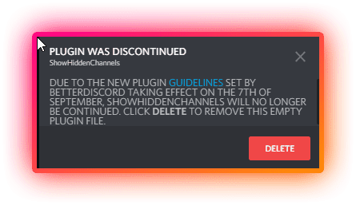

# betterdiscord-showhiddenchannels
On September 5, 2025, [BetterDiscord updated the Security and Privacy section of their plugin guidelines page](https://web.archive.org/web/20220905083412/https://docs.betterdiscord.app/plugins/introduction/guidelines/) to prohibit plugins from accessing potentially sensitive information, such as hidden channels in a Discord server. As a result, the [ShowHiddenChannels plugin](https://web.archive.org/web/20220903021512/https://betterdiscord.app/plugin/ShowHiddenChannels) developed by DevilBro was removed from BetterDiscord's public plugins repository.

BetterDiscord at that time did not have a plugin auto-updater, so if a new version of a plugin were to release then users would have to navigate to the BetterDiscord plugins repository and redownload the updated plugin. Some plugins included a custom auto-updater function, this include's DevilBro's plugins that depended on his 0BDFDB library. Using the plugin auto-updater included in his 0BDFDB library, version `9.9.9` of the ShowHiddensPlugin channel was pushed with the existing functionality removed and with a new notification prompting the user to delete the ShowHiddenChannel's plugin as BetterDiscord's new plugin guidelines now conflict with the plugin.

  

For archival purposes, an unmodified version of the ShowHiddenChannels plugin is included in this repository. Attempting to download this version of the plugin and placing it in your BetterDiscord's plugins folder will result in DevilBro's plugin updater replacing the plugin with the `9.9.9` version of ShowHiddenChannels. It is possible to circumvent the auto-updater by editing the plugin file and changing the version to `9.9.9`, and while this would work to be able to continue to be able to see hidden channels in Discord servers, it will eventually break when DevilBro removes the assets that ShowHiddenChannels depends on from his 0BDFDB library.

## What to do now?
BetterDiscord is an ancient modification for the Desktop version of Discord and should not be used in present day. Alternatives such as [Vencord](https://vencord.dev/) are far better than BetterDiscord. I personally recommend Vencord as it is more maintained, not prone to memory leaks, includes plugins such as ShowHiddenChannels and MessageLogger, and is cute!

If you wish to continue using BetterDiscord, a list of working plugins for BetterDiscord that include the original functionality of ShowHiddenChannels can be found at https://github.com/MrDiamond64/betterdiscord-showhiddenchannels/issues/1#issuecomment-1237831754

## Useful Links
Original Plugin File: https://github.com/mwittrien/BetterDiscordAddons/blob/b510da9b3ad72ba3b773f7d79e391a459f31732d/Plugins/ShowHiddenChannels/ShowHiddenChannels.plugin.js

Old BDFDB Library Assets: https://github.com/mwittrien/BetterDiscordAddons/tree/b510da9b3ad72ba3b773f7d79e391a459f31732d